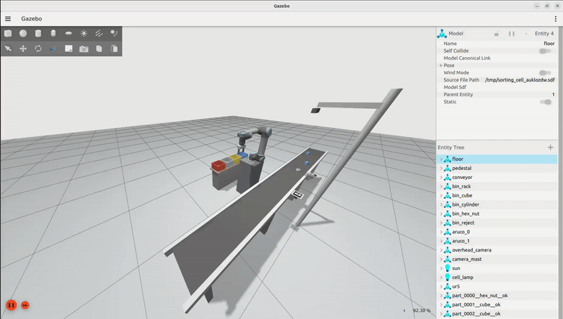
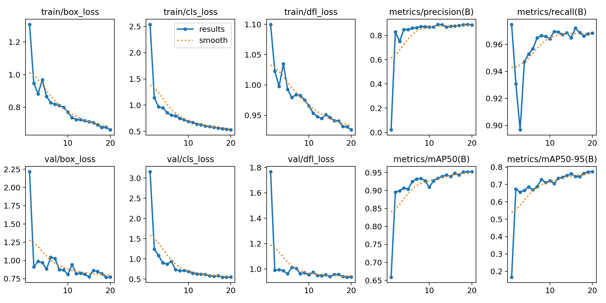
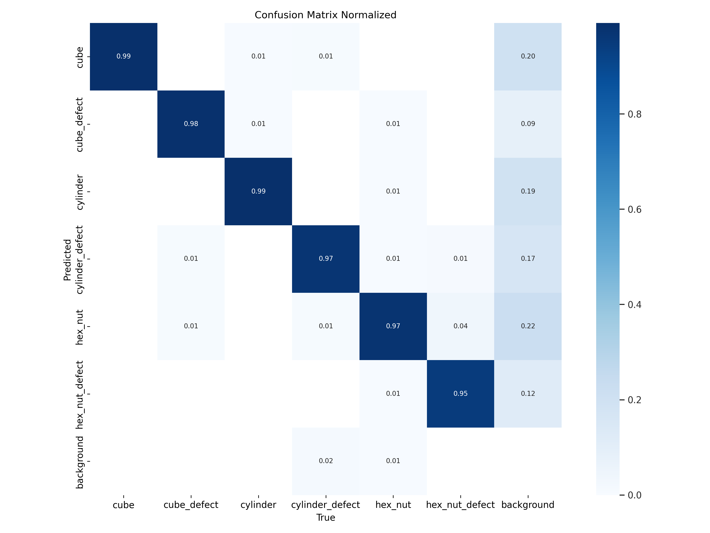
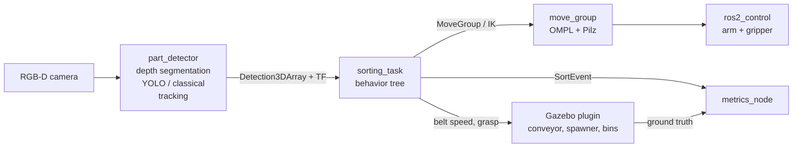

# UR5 Smart Sorting Cell

[](https://github.com/mustafa11313/ur5_sorting_cell/actions/workflows/ci.yml)


A UR5 with a parallel gripper works next to a conveyor on a simulated production
line. Parts arrive at random positions and orientations; an overhead RGB-D camera
detects and classifies them (YOLOv8 or a classical baseline), estimates their pose
from depth, and a behavior tree picks each part with MoveIt 2 and drops it into the
right bin: one bin per part type, plus a reject bin for defective parts.



*The cell sorting parts in Gazebo (3x speed).*

**Highlights**

* End-to-end ROS 2 Humble stack: Gazebo Fortress, `gz_ros2_control`, MoveIt 2 (OMPL + Pilz), py_trees, Ultralytics YOLO.
* A custom Gazebo system plugin (C++) for the conveyor, a seeded part spawner, a grasp assist and ground-truth bookkeeping.
* Colour-independent pose estimation from depth (about 1 to 2 mm position error in simulation) fused with a learned classifier.
* Auto-labelled synthetic dataset generation with domain randomization, and a reproducible training script.
* Grasp planning that respects part symmetry and avoids neighbouring parts, so touching parts can be picked.
* ArUco-based camera extrinsic calibration.
* A metrics node and a benchmark runner covering five scenarios: nominal, touching parts, new variants, dim light and a fast belt.
* Unit tests, flake8 and a GitHub Actions workflow; Docker image for a one-command setup.

## Results

Every scenario runs headless for 300 simulated seconds with the same seed
(`scripts/run_evaluation.py`). The belt carries cubes, cylinders and hex nuts,
a quarter of them with a red defect mark. YOLO backend:

| Scenario | Parts | Pick success | Sorting acc. | Throughput [ppm] | Cycle time [s] | Class. acc. | Defect P / R | Failed grasps | Plan fails | Missed |
|---|---|---|---|---|---|---|---|---|---|---|
| nominal | 43 | 100.0 % | 100.0 % | 6.4 | 6.42 | 100.0 % | 100.0 % / 100.0 % | 0 | 0 | 0 |
| touching | 62 | 100.0 % | 97.0 % | 6.38 | 6.31 | 97.0 % | 100.0 % / 100.0 % | 0 | 0 | 0 |
| new_variants | 44 | 100.0 % | 100.0 % | 6.38 | 6.43 | 100.0 % | 100.0 % / 100.0 % | 0 | 0 | 0 |
| dim_light | 43 | 100.0 % | 100.0 % | 6.2 | 6.56 | 100.0 % | 100.0 % / 100.0 % | 0 | 0 | 0 |
| fast_belt | 75 | 100.0 % | 94.4 % | 6.8 | 6.26 | 97.1 % | 100.0 % / 100.0 % | 0 | 0 | 10 |

* **touching**: pairs of parts spawned in contact; the depth blob is split by the detector boxes.
* **new_variants**: ±15 % part size and shifted colours.
* **dim_light**: dim, low-angle light and four times the camera noise (a dim setting is also in the training data).
* **fast_belt**: twice the belt speed and a part every 4 s instead of 7 s, more than
  the robot can sort. The supervisor stops the belt when it falls behind; parts
  that still reach the end count as missed.

The detector (YOLOv8n fine-tuned on 1,200 auto-labelled simulation images)
reaches mAP50 0.95 and mAP50-95 0.77 on the validation split:

<p float="left">
  
  
</p>

### YOLO vs. the classical baseline

The same scenarios with `backend:=classical`, which uses hand-written rules on the
measured height and shape and a red-pixel check for defects
([full table](results/classical/summary.md)):

| Scenario | Pick success (YOLO / classical) | Sorting accuracy (YOLO / classical) |
|---|---|---|
| nominal | 100 % / 100 % | 100 % / 100 % |
| touching | 100 % / 100 % | 97.0 % / 90.9 % |
| new_variants | 100 % / 100 % | 100 % / 96.9 % |
| dim_light | 100 % / 0 % | 100 % / n/a |
| fast_belt | 100 % / 56.9 % | 94.4 % / 79.3 % |

The rules hold up in good conditions but break down when they're pushed. Under
the dim scenario's higher sensor noise, they accept depth noise as parts and
misjudge heights, so every pick missed (0 of 17 attempts before the run was
stopped). The learned detector only lets through depth blobs that it also sees
in the image, which filters out the phantom parts.

## Architecture



Perception → decision → action, one ROS 2 package per concern:

| Package | What it does |
|---|---|
| `sorting_cell_description` | UR5 (from `ur_description`) on a pedestal, parallel gripper, `ros2_control` tags |
| `sorting_cell_gazebo` | World template and the `SortingCellSystem` plugin (conveyor, spawner, grasp assist, bins) |
| `sorting_cell_moveit_config` | SRDF, kinematics, OMPL and Pilz pipelines, controllers |
| `sorting_cell_perception` | Detector node, tracker, dataset recorder, YOLO training, ArUco calibration |
| `sorting_cell_task` | Behavior tree, grasp planner, MoveIt helpers, planning scene, metrics |
| `sorting_cell_interfaces` | `SortEvent` message |
| `sorting_cell_bringup` | Launch files, scenarios, cell geometry, RViz config |

The full design (plugin internals, perception pipeline, tree, motion strategy and
the path to real hardware) is in [docs/architecture.md](docs/architecture.md).

## Quick start

### Option A: native ROS 2 Humble (Ubuntu 22.04)

The setup script installs everything, builds the workspace and runs the tests:

```bash
mkdir -p ~/sorting_ws/src && cd ~/sorting_ws/src
git clone https://github.com/mustafa11313/ur5_sorting_cell.git
bash ur5_sorting_cell/scripts/setup_humble.sh
source ~/sorting_ws/install/setup.bash
ros2 launch sorting_cell_bringup sorting_cell.launch.py
```

Or step by step:

```bash
sudo apt install ros-humble-moveit ros-humble-pilz-industrial-motion-planner \
  ros-humble-ros2-control ros-humble-ros2-controllers ros-humble-gz-ros2-control \
  ros-humble-ur-description ros-humble-ros-gz ros-humble-py-trees ros-humble-vision-msgs
pip3 install --index-url https://download.pytorch.org/whl/cpu torch torchvision
pip3 install "ultralytics==8.3.40" "numpy<2" "setuptools<70"

mkdir -p ~/sorting_ws && cd ~/sorting_ws
git clone https://github.com/mustafa11313/ur5_sorting_cell.git src/ur5_sorting_cell
rosdep install --from-paths src --ignore-src -y
colcon build --symlink-install
source install/setup.bash

ros2 launch sorting_cell_bringup sorting_cell.launch.py
```

Gazebo opens with the cell and RViz shows the planning scene, the planned motions
and the live detections. Parts start arriving after two seconds.

### Option B: Docker

```bash
xhost +local:docker
docker compose -f docker/compose.yaml build
docker compose -f docker/compose.yaml run --rm cell \
  ros2 launch sorting_cell_bringup sorting_cell.launch.py
```

Use the `cell-nvidia` service instead of `cell` on a machine with an NVIDIA GPU
(build with `--build-arg TORCH_INDEX=https://download.pytorch.org/whl/cu121`).

### Useful launch arguments

| Argument | Default | Meaning |
|---|---|---|
| `scenario` | `nominal` | `nominal`, `touching`, `new_variants`, `dim_light`, `fast_belt`, or a YAML path |
| `backend` | `yolo` | `yolo` or `classical` (YOLO falls back to classical if no weights are found) |
| `headless` | `false` | Gazebo server only |
| `rviz` | `true` | Start RViz |
| `world_overrides` | | Override any world parameter, e.g. `"belt_speed=0.12 sun=0.3"` |
| `camera_extrinsics` | | Calibrated extrinsics YAML (see below) |
| `render_engine` | `ogre2` | Use `ogre` on old or virtual GPUs |
| `eval_duration` | `0` | Shut down after this many simulated seconds and write the metrics |

## Reproducing the results

```bash
# 1. dataset: auto-labelled images under four lighting / variant settings
ros2 launch sorting_cell_perception record_dataset.launch.py output_dir:=$HOME/sorting_dataset max_images:=500 prefix:=base
ros2 launch sorting_cell_perception record_dataset.launch.py output_dir:=$HOME/sorting_dataset max_images:=350 prefix:=dim \
    world_overrides:="sun=0.3 lamp=0.15 ambient=0.2 sun_direction=-0.8,0.5,-0.4 image_noise=0.02"
ros2 launch sorting_cell_perception record_dataset.launch.py output_dir:=$HOME/sorting_dataset max_images:=350 prefix:=bright \
    world_overrides:="sun=1.0 lamp=0.7 ambient=0.6 sun_direction=0.4,-0.3,-1.0"

# 2. training (CPU works; add --device 0 for a GPU)
ros2 run sorting_cell_perception train_yolo --data $HOME/sorting_dataset/data.yaml \
    --out src/ur5_sorting_cell/src/sorting_cell_perception/models/parts_yolo.pt

# 3. benchmark every scenario (headless) and build the summary table
python3 src/ur5_sorting_cell/scripts/run_evaluation.py --backend yolo --duration 400
```

## Camera calibration

Two ArUco markers (DICT_4X4_50, ids 0 and 1) sit next to the belt at known poses.
`calibrate_camera` solves PnP on their eight corners over 20 frames and writes
an extrinsics file:

```bash
ros2 run sorting_cell_perception calibrate_camera --ros-args \
  -p cell_config:=$(ros2 pkg prefix sorting_cell_bringup)/share/sorting_cell_bringup/config/cell.yaml \
  -p output:=$HOME/camera_extrinsics.yaml
ros2 launch sorting_cell_bringup sorting_cell.launch.py camera_extrinsics:=$HOME/camera_extrinsics.yaml
```

In a test where the simulated camera was bumped by a few centimetres and a few
degrees, the nominal extrinsics put every part outside the belt region and the
cell stopped picking. One calibration run (reprojection RMS 0.60 px) brought the
part position error back to about 1 mm and the cell back to normal operation.

## Tests

```bash
colcon test --packages-select sorting_cell_description sorting_cell_perception sorting_cell_task sorting_cell_bringup
colcon test-result --verbose
```

The tests cover the depth pipeline on synthetic depth images, the tracker, PnP
calibration, grasp planning around touching parts, the metrics and every
scenario's world file.

## Design choices and limitations

* **Grasp assist instead of friction grasping.** The plugin attaches the part
  to the TCP when the gripper closes on it. Grasps still fail when perception or
  planning is wrong (nothing within 3 cm of the TCP), and random slips can be
  injected with `slip_probability`. Real contact-rich grasping is a hardware
  question; this project focuses on perception, decisions and motion.
* **Stop-and-pick.** The belt stops while a part is picked and restarts as soon
  as the part is lifted. Picking from a moving belt (tracking the part with
  MoveIt Servo) would be the next step for throughput.
* **Ground truth is used only for evaluation and dataset labels**, never by
  the robot.
* **Sim-to-real.** The interfaces (controllers, topics, frames) match the real
  `ur_robot_driver` and common camera drivers; see the table at the end of
  [docs/architecture.md](docs/architecture.md).

## Repository layout

```
docker/            Dockerfile and compose file
docs/              architecture notes and media
scripts/           setup script, benchmark runner, video recorder, marker generator
results/           benchmark outputs (metrics.json and report.md per scenario)
src/
  sorting_cell_bringup/        launch files, scenarios, cell.yaml, RViz
  sorting_cell_description/    URDF/xacro
  sorting_cell_gazebo/         world template + SortingCellSystem plugin (C++)
  sorting_cell_interfaces/     SortEvent.msg
  sorting_cell_moveit_config/  MoveIt 2 config
  sorting_cell_perception/     detector, tracker, dataset, training, calibration
  sorting_cell_task/           behavior tree, grasp planner, metrics
```

## License

AGPL-3.0 (see [LICENSE](LICENSE)). The perception backend and the bundled
model are built on [Ultralytics YOLOv8](https://github.com/ultralytics/ultralytics),
which is AGPL-3.0, so this project uses the same license. The UR5 model comes from
`ur_description` (BSD-3-Clause) and is not redistributed here.
