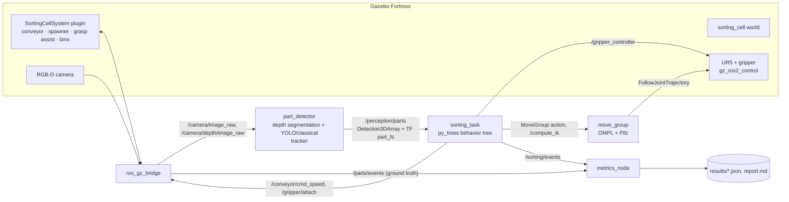

# Architecture and design notes

The cell follows a classic **perception → decision → action** split. Every box
below is a ROS 2 node; arrows are topics, actions or services.



## Simulation (`sorting_cell_gazebo`)

The world is an SDF template rendered per scenario by
`sorting_cell_bringup/world_builder.py`, so an experiment is fully described by
one small YAML file (belt speed, part mix, defects, clustering, size/colour
jitter, light, sensor noise, seed).

A single C++ system plugin, `SortingCellSystem`, runs the production line:

* **Conveyor.** Every free part whose pose lies on the belt receives a
  velocity command (expressed in the part's frame, as the physics system
  expects). Parts keep their own dynamics: they collide, can touch each other
  and fall off the end.
* **Spawner.** Random part type, defect, yaw, lateral offset, size and colour
  jitter, and optional touching pairs; all driven by a seeded RNG for
  repeatable experiments. Parts are named `part_<n>__<type>__<ok|defect>`,
  which is the ground truth used by the evaluation and the dataset labeller.
* **Grasp assist.** When `/gripper/attach` goes true, the part closest to the
  TCP (within 3 cm) is rigidly attached to it until the gripper opens.
  Friction grasping with position-controlled fingers is notoriously jittery in
  simulation and would mostly measure physics-engine artefacts; the assist
  keeps the focus on perception, planning and decision making. Grasps still
  fail realistically when the TCP is not where the part is (wrong pose
  estimate, wrong height, part moved), and `slip_probability` can inject
  random failures.
* **Bookkeeping.** Parts resting inside a bin for 1.5 s are reported
  (`binned <part> <bin>`) and removed, as are parts that leave the belt
  (`missed`) or fall to the floor (`dropped`).

## Perception (`sorting_cell_perception`)

1. **Depth → world.** Each depth pixel is back-projected with the camera
   intrinsics and transformed with the calibrated extrinsics from TF. The
   height above the known belt plane separates parts from the belt, which
   makes segmentation independent of colour and lighting.
2. **Measurement.** For each blob the top surface is used to fit a minimum
   area rectangle in metric world coordinates: centre, yaw of the long side,
   length, closing width and height. Touching parts are separated by the
   detector boxes (YOLO) or a distance-transform watershed (classical).
3. **Classification.** Two interchangeable backends:
   * `yolo`: a YOLOv8n detector fine-tuned on auto-labelled simulation
     images. Each box is matched to a depth blob; the box gives the class,
     the blob gives the geometry.
   * `classical`: rules on the measured geometry (height, fill ratio) plus a
     colour cue for the red defect marks. It doubles as a baseline.
4. **Tracking.** A constant-velocity tracker along the belt keeps stable ids
   (`part_<id>` TF frames) and smooths the class by confidence-weighted voting.
5. **Calibration.** `calibrate_camera` solves PnP on two ArUco markers next to
   the belt and writes the extrinsics YAML that the launch files load.

The dataset recorder labels images automatically by matching depth blobs with
the ground-truth poses from the plugin, splitting merged blobs between the
parts they contain.

## Decision making (`sorting_cell_task`)

`sorting_task` ticks a py_trees behavior tree:

```
cycle_or_recover (Selector)
├── sort_one_part (Sequence)
│   ├── WaitForPart      belt runs until a part reaches the pick position
│   ├── StopBelt
│   ├── Settle           wait for detections taken after the belt stopped
│   ├── Retry x2
│   │   └── pick (Sequence)
│   │       ├── SelectTarget   most downstream part + collision-free grasp
│   │       └── PickPart       approach (PTP) · descend (LIN) · close · verify · lift (LIN)
│   ├── ResumeBelt       the belt restarts while the robot places the part
│   ├── PlacePart        transfer to the bin chosen from the class
│   └── ReportResult
└── recover (Sequence)
    ├── ReportFailure
    ├── GoReady
    └── ResumeBelt
```

Long-running actions run in worker threads so the tree keeps ticking. A
separate belt supervisor stops the belt whenever a part is about to leave the
reachable window while the robot is still busy, which is what keeps the miss
rate down when parts arrive faster than the robot can sort them.

**Grasp planning** (`grasp.py`) enumerates the grasp angles allowed by the
part's symmetry (90° for cubes, 60° for hex nuts, any for cylinders), rejects
those whose fingers would hit a neighbouring part, and picks the most
wrist-friendly of the rest; if a wide approach does not fit, a narrow one is
tried. The fingertip height is clamped so the fingers never touch the belt.

**Sorting rule**: defective parts and parts classified with low confidence go
to the reject bin; good parts go to the bin of their type.

## Motion (`sorting_cell_moveit_config`)

* Pilz **PTP** for transfers. The goal is converted to joints with a seeded
  `/compute_ik` call (seed = ready pose turned towards the target) so the
  joint-space motion stays elbow-up and never swings through the pedestal.
* Pilz **LIN** for the vertical approach and retreat.
* **OMPL RRTConnect** as a collision-avoiding fallback.
* The static cell is added to the planning scene by `planning_scene`, and the
  held part is attached to the TCP as a collision object during transfers.

## From simulation to the real robot

The interfaces were chosen so that the simulation-only pieces can be swapped
out one at a time:

| Simulation | Real cell |
|---|---|
| `gz_ros2_control` hardware | `ur_robot_driver` (same controllers and joint names) |
| Grasp assist plugin | real gripper driver (e.g. Robotiq) behind the same gripper action, grasp check from finger position or vacuum sensor |
| Gazebo RGB-D camera | RealSense / Zivid driver publishing the same topics |
| ArUco extrinsics from known marker poses | hand-eye calibration (e.g. easy_handeye2) |
| Conveyor plugin topic | PLC / VFD interface publishing the same speed topic |
| Ground-truth evaluation | operator labels or a downstream checkpoint |
